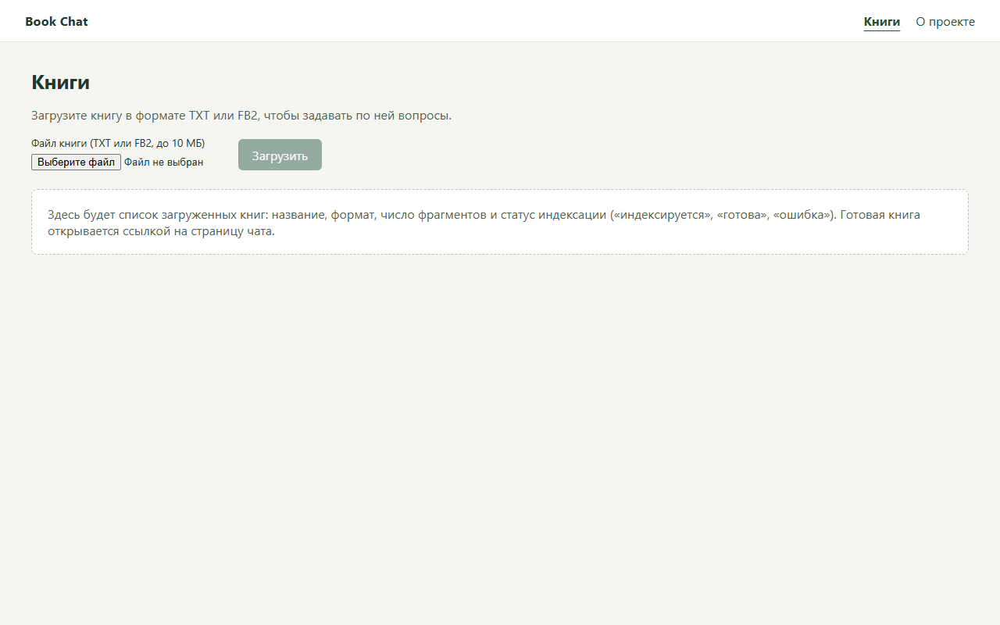
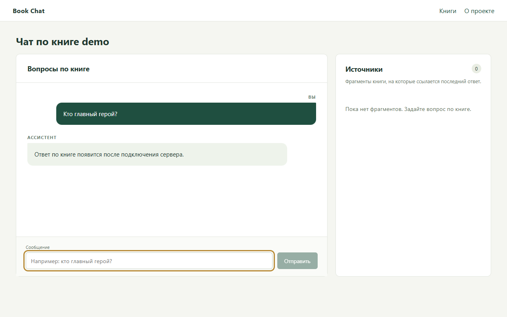
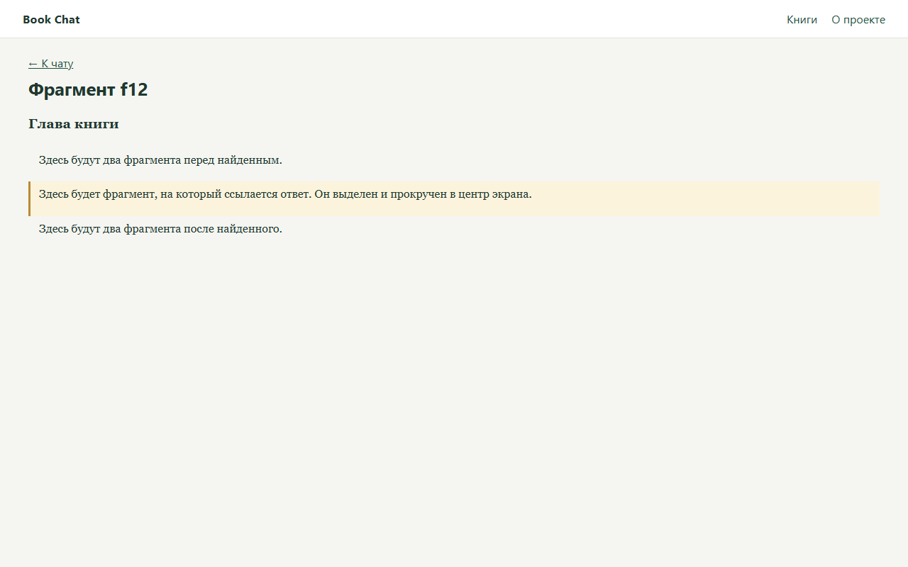

# Book Chat Assistant

Чат-ассистент по загруженной книге: отвечает на вопросы по тексту и показывает фрагменты, на которых основан ответ.

Курсовая работа по курсу JavaScript, тема 41: «Разработка чат-ассистента на основе собственной базы знаний с поиском релевантных фрагментов и ответом с контекстом с использованием Node.js».

- [architecture.md](architecture.md) — проекты, библиотеки, компоненты, роутинг, API.
- [mvp.md](mvp.md) — основной use case и границы MVP.

## Состав

| Папка | Что это |
| --- | --- |
| `ui-library` | Библиотека React-компонентов `@book-chat/ui-library` |
| `frontend` | Веб-приложение на React и Vite |
| `server` | Сервер на Node.js и Express |

## Текущий этап: каркас (лабораторная 5)

Все страницы, маршруты и компоненты из `architecture.md` созданы. Компоненты библиотеки рабочие и покрыты тестами, страницы пока показывают заглушки с описанием будущего содержимого. Сервер отвечает на `/api/health`, остальные маршруты API есть и возвращают заглушки.

## Требования

- Node.js 24 и npm 11
- Для MVP: Docker (Qdrant) и Ollama с моделями `qwen3-embedding:0.6b` и `qwen3:4b`

## Запуск

Команды выполняются из корня репозитория. Библиотеку нужно собрать до запуска приложения.

```powershell
cd ui-library
npm ci
npm run build

cd ../frontend
npm ci
npm run dev
```

Приложение откроется на http://localhost:5173.

Сервер (в отдельном терминале):

```powershell
cd server
npm ci
copy .env.example .env
npm run dev
```

Проверка: http://localhost:3001/api/health → `{"status":"ok"}`.

## Проверки

В каждой из папок `ui-library`, `frontend`, `server`:

```powershell
npm run lint
npm test
npm run test:coverage
npm run build
```

Покрытие `SourcesPanel` в библиотеке — 100% по всем столбцам.

## Скриншоты

Список книг и загрузка:



Чат с панелью источников:



Просмотр фрагмента:


