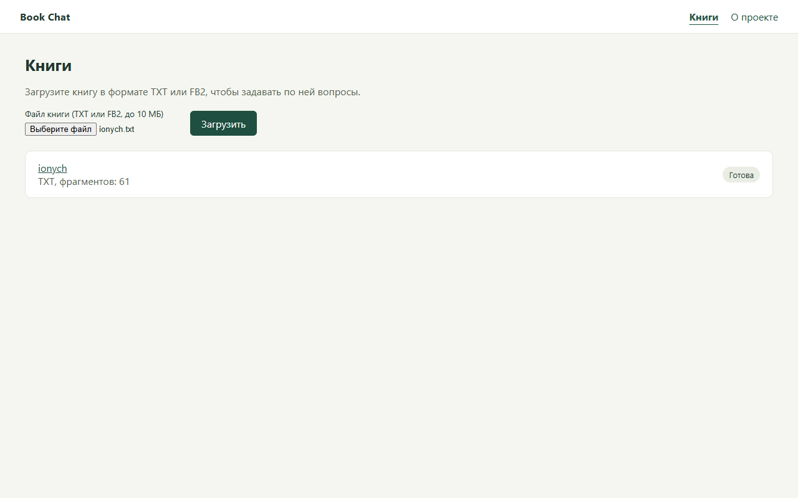
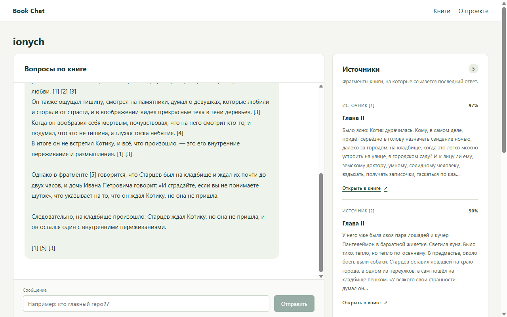
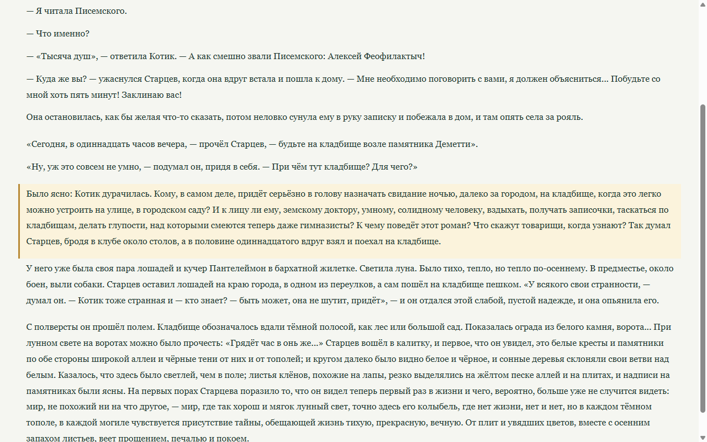

# Book Chat Assistant

Чат-ассистент по загруженной книге: отвечает на вопросы по тексту и показывает фрагменты, на которых основан ответ.

Курсовая работа по курсу JavaScript, тема 41: «Разработка чат-ассистента на основе собственной базы знаний с поиском релевантных фрагментов и ответом с контекстом с использованием Node.js».

- [architecture.md](architecture.md) — проекты, библиотеки, компоненты, роутинг, API.
- [mvp.md](mvp.md) — основной use case и границы MVP.

## Что умеет MVP

1. Загрузка книги в формате TXT (UTF-8 или windows-1251) или FB2, до 10 МБ.
2. Разбиение текста на фрагменты с привязкой к главам и индексация: векторы в Qdrant, полнотекстовый индекс BM25.
3. Вопрос по книге: гибридный поиск (векторный + BM25, объединение методом RRF), ответ локальной модели со ссылками `[1]`, `[2]` на фрагменты.
4. Панель источников с главой, текстом и релевантностью; переход к фрагменту в тексте книги с выделением и соседними фрагментами.
5. История диалога по каждой книге сохраняется на сервере.

Всё работает локально: языковая модель и модель embeddings запускаются в Ollama, платные API не нужны.

## Состав

| Папка | Что это |
| --- | --- |
| `ui-library` | Библиотека React-компонентов `@book-chat/ui-library` |
| `frontend` | Веб-приложение на React и Vite |
| `server` | Сервер на Node.js и Express |
| `docker-compose.yml` | Qdrant |

## Требования

- Node.js 24 и npm 11
- Docker (для Qdrant)
- [Ollama](https://ollama.com) с моделями:

```powershell
ollama pull qwen3-embedding:0.6b
ollama pull qwen3:4b-instruct
```

Модели занимают около 3 ГБ. Ответ на вопрос на ноутбучной видеокарте с 4 ГБ памяти занимает несколько секунд.

## Запуск

Команды выполняются из корня репозитория, каждая часть — в своём терминале.

1. Qdrant:

```powershell
docker compose up -d
```

2. Сервер (порт 3001):

```powershell
cd server
npm ci
copy .env.example .env
npm run dev
```

3. Библиотека и приложение (порт 5173):

```powershell
cd ui-library
npm ci
npm run build
cd ../frontend
npm ci
npm run dev
```

Открыть http://localhost:5173, загрузить книгу, дождаться статуса «Готова» и открыть её.

### Настройки сервера (`server/.env`)

| Переменная | По умолчанию | Назначение |
| --- | --- | --- |
| `PORT` | `3001` | порт сервера |
| `OLLAMA_URL` | `http://127.0.0.1:11434` | адрес Ollama |
| `CHAT_MODEL` | `qwen3:4b-instruct` | модель для ответов |
| `EMBED_MODEL` | `qwen3-embedding:0.6b` | модель embeddings |
| `QDRANT_URL` | `http://127.0.0.1:6333` | адрес Qdrant |

Загруженные книги и история чатов хранятся в `server/data`, векторы — в `qdrant_storage`. Обе папки в git не попадают.

## Ограничения MVP

- Поиск без повторного ранжирования. Маленькая модель embeddings плохо связывает косвенные формулировки: на вопрос «Почему Котик отказала Старцеву?» нужный фрагмент (реплика героини о консерватории) не попадает в выдачу, и ассистент честно отвечает «В книге не нашлось ответа». Reranking и подбор параметров запланированы на следующий этап.
- Ответ строится по 10 найденным фрагментам, поэтому вопросы «по всей книге сразу» (например, пересказ) не поддерживаются.

## Проверки

В каждой из папок `ui-library`, `frontend`, `server`:

```powershell
npm run lint
npm test
npm run test:coverage
npm run build
```

Тесты сервера не обращаются к Ollama и Qdrant: эти модули подменяются заглушками. Покрытие `SourcesPanel` в библиотеке — 100% по всем столбцам.

## Скриншоты

Список книг после загрузки:



Ответ со ссылками и панель источников:



Фрагмент книги, на который ссылается ответ:


